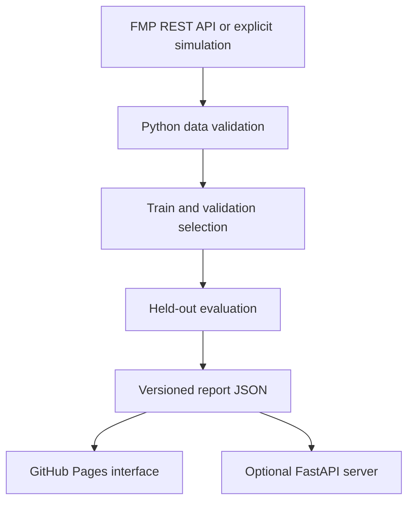

# IndexLens · Asset Tracker

**Less to hold. More to understand.**

IndexLens explores a simple question: how closely can a small stock portfolio
track a broad equity benchmark? It combines a Python research engine, a documented
FastAPI interface, and an interactive frontend built for GitHub Pages.

Source: [venkatkota2/asset-tracker](https://github.com/venkatkota2/asset-tracker).
To activate the website for this repository, select **Settings → Pages → Source →
GitHub Actions**, then run **Build research and deploy Pages** from the Actions tab.

**The checked-in example uses explicitly labeled, deterministic simulated data.**
It contains 500 fictional assets, not historical S&P 500 prices. To run genuine
S&P 500 research, enable the Financial Modeling Prep (FMP) provider with an API
key whose plan covers the required endpoints. No key is included in this repo.

## What you can explore

- Compare 5, 10, 15, 20, 30, 40 and 60-stock budgets.
- Let Python pick a balance between fewer positions and lower validation error.
- Inspect a separate held-out test period: tracking error, correlation, return
  difference, and portfolio/benchmark growth curves.
- Explore positions, sector allocations, illustrative dollar allocations, and CSV exports.
- Read the exact observation windows, assumptions, exclusions and limitations in the UI.

Only S&P 500 research is enabled initially. Real-data mode uses dividend- and
split-adjusted **SPY** prices as a total-return proxy, not the price-only S&P 500
index and not the licensed official S&P 500 Total Return Index.

## Run locally

Requires Python 3.11+ (tested with 3.12); no frontend build or npm installation.

```bash
python -m venv .venv
source .venv/bin/activate
python -m pip install -e '.[dev]' -c requirements.lock
python -m indexlens.cli build --provider demo
python -m uvicorn indexlens.api:app --reload
```

Open `http://localhost:8000` for the app and `http://localhost:8000/docs` for the
OpenAPI documentation. On Windows use `.venv\Scripts\activate`.

For just the static frontend, run `python -m http.server 8000 --directory web`.
Open it over HTTP, not by double-clicking `index.html`, because it fetches JSON.
The downloadable source archive also includes `preview.html`, a self-contained
simulated demo you can open directly. Rebuild that archive with
`python scripts/package_release.py`.

## Publish a new GitHub repository and Pages website

With the [official GitHub CLI](https://cli.github.com) installed and signed in,
run from this project directory:

```bash
gh auth login
bash scripts/publish_github.sh your-new-repository-name
```

The script tests the project, creates a **new public repository**, pushes source,
enables GitHub Pages with GitHub Actions, and starts deployment. It stops if the
repository name already exists; it never overwrites an existing repository.
View the resulting URL in the repository's Actions or Settings → Pages screen.

Alternatively, create an empty GitHub repository, push this project, and select
**Settings → Pages → Source → GitHub Actions**. The `pages.yml` workflow builds
the report and deploys the `web/` directory on pushes, manual runs, and weekday
evenings at 22:30 UTC. Scheduled workflows are best-effort, and GitHub may disable
inactive repository schedules. No current/real-time label is used.

### Hosting architecture

GitHub Pages is static hosting and cannot run a persistent Python web server.
This project keeps its numerical backend in Python by running it in GitHub
Actions and publishing the resulting report. Browser controls explore that
precomputed frontier immediately, without exposing a data-provider key.



The optional FastAPI service serves reports and computes dollar allocations;
it does **not** fetch 500 price histories or rerun optimization on anonymous
visitor requests. The CLI/job owns ingestion and optimization. A `Dockerfile`
is included for a Python host. No paid hosting account is created automatically.
To connect Pages to a separately hosted API, set `apiBase` in `web/config.js`
and allow the exact frontend origin in the server's `CORS_ORIGINS`.

## Connect real market data

FMP endpoints used:

| Purpose | Stable REST endpoint | Required field |
|---|---|---|
| Current S&P 500 constituents | `/stable/sp500-constituent` | `symbol`, `name`, `sector` |
| Adjusted daily stock and SPY prices | `/stable/historical-price-eod/dividend-adjusted` | `date`, `adjClose` |

The provider uses explicit timeouts, pacing, capped retries for rate limits and
server errors, a local expiring cache, response validation, and sanitized errors.
It requires complete training histories on benchmark dates and reports excluded
assets. If a training-eligible asset has missing validation or test prices, the
run fails instead of changing the universe using future data availability. It
never interpolates prices or substitutes raw closes for adjusted closes. New
listings may be excluded; that selection is an important research limitation.

For a local run, securely set `FMP_API_KEY` in the environment, then:

```bash
python -m indexlens.cli build --provider fmp --start 2022-01-01 --end 2026-10-26
```

The default date range is approximately four years through yesterday. Set
`FMP_REQUESTS_PER_MINUTE` to your plan's quota (default 120). The entire universe
requires roughly 500 historical-series requests plus SPY and constituent data.
Plan coverage varies; this is **not** represented as a free unlimited API.

For GitHub Actions:

1. Add `FMP_API_KEY` as a repository **Actions secret**, never a public variable.
2. Set repository Actions variable `DATA_PROVIDER` to `fmp`.
3. Optionally set `FMP_REQUESTS_PER_MINUTE` to match the provider plan.
4. Run **Build research and deploy Pages**.

Confirm your data license permits the public derived display you enable. Only
derived portfolio results are published; raw stock price panels and the API key
are excluded. Provider access or data validation failures fail the build and
preserve the existing live report. They never silently replace market data with
simulation. To return to demonstration mode, explicitly set `DATA_PROVIDER=demo`.

## Methodology

Let `X` contain candidate daily total returns and `y` the benchmark returns. For
each support, solve a ridge-regularized least-squares problem with:

- `sum(weights) = 1`;
- `0 <= weight <= 25%` at the rebalance;
- at most `k` selected stocks.

The optimizer scales returns to percentage points for solver stability. It
minimizes mean squared return difference plus `1e-4 * ||weights||²`. There is
no intercept, no leverage, and no shorting. Sparsity comes from explicit greedy
support selection. Adding an L1 penalty on a long-only, fully invested portfolio
would not induce sparsity because its L1 norm is always one.

The greedy search is a deterministic approximation, not a guarantee of the
globally best cardinality-constrained portfolio. Some selected weights may be
zero; the UI distinguishes the budget from the actual holding count.

### Chronological separation

| Window | Fraction | Permitted use |
|---|---|---|
| Train | First 60% | Choose nested supports and initial weights |
| Validation | Next 20% | Choose the holding budget |
| Test | Final 20% | Evaluate only; never tune the automatic choice |

For the automatic balance, normalize holding budget and validation annualized
tracking RMSE onto `[0,1]` using the tested grid. Minimize
`0.5 * normalized_budget² + 0.5 * normalized_RMSE²`. Ties prefer fewer stocks.
This explicitly gives simplicity and precision equal importance. It is a
grid-dependent research preference, not a statistically unique best answer.

After selecting the budget, keep each training-selected support fixed and refit
weights on train + validation. These are the weights shown at the **start of the
test**, not today's proposed trades. The test results shown for other sizes are
comparisons only. Choosing a different size after seeing test outcomes would
make that test a tuning set; a further forward period would then be needed.

### Trading and evaluation

The backtest begins fully invested after the initial purchase cost, lets weights
drift, and rebalances to target weights every 63 observed sessions. It deducts
5 bps per dollar traded on the initial purchase and subsequent purchases/sales.
Fractional holdings are assumed. The last observation does not liquidate the
portfolio. Costs are multiplicative with the period return.

- **Tracking error:** sample standard deviation of daily active returns × √252.
- **Tracking RMSE:** square root of mean squared daily active returns × √252.
- **Correlation:** Pearson correlation of daily portfolio and benchmark returns;
  this is not a percentage accuracy score.
- **Return difference:** cumulative portfolio return minus benchmark return,
  displayed in percentage points.
- An equal-weight entire-universe baseline is included in the report JSON.

### Limits that matter

Current constituent membership is used retrospectively. Survivorship bias and
complete-history selection bias remain; the model is **not** a point-in-time
historical index replication strategy. Adjusted history can also be revised by
providers. There is one chronological holdout rather than a full walk-forward
study. Further evaluation should include historical membership, delisted stocks,
rolling refits, turnover constraints, market impact, taxes and alternative market
regimes. The current concentration limit can be exceeded by drift between
rebalances. Historical closeness cannot guarantee future tracking performance.

## API

| Method | Route | Result |
|---|---|---|
| GET | `/api/health` | Service and report availability |
| GET | `/api/benchmarks` | Supported benchmark registry |
| GET | `/api/report` | Full versioned report/frontier |
| POST | `/api/portfolio` | Published budget and dollar allocations |

Example request body:

```json
{"benchmark":"sp500","max_holdings":20,"capital":10000}
```

Omit `max_holdings` to use the automatic choice. Only published budgets are
accepted; unsupported symbols and arbitrary sizes return validation errors.
No visitor-supplied URL is fetched and no provider key is accepted in the frontend.

## Validation

```bash
OPENBLAS_NUM_THREADS=1 OMP_NUM_THREADS=1 python -m pytest -q
node --check web/app.js
```

Tests cover exact recovery of a known portfolio, weight constraints, infeasible
caps, chronological leakage (altering held-out returns cannot change weights or
selection), missing-price exclusions, cost/turnover arithmetic, drawdowns,
tracking error versus bias, provider contract failures, retries, caching, secret
redaction, and FastAPI inputs/results. The FMP adapter is tested with HTTP mocks;
an authenticated end-to-end provider run requires your key and plan.

## Project layout

```text
src/indexlens/       Python provider, optimizer, backtest, report builder and API
tests/              Numerical, leakage, provider and API tests
web/                Responsive frontend and generated report.json
.github/workflows/  CI and Python-powered Pages publication
scripts/            Safe deployment metadata and new-repository setup
docs/               Extension guide
```

See [the extension guide](docs/extending.md) for future asset classes and custom
benchmark support. Code is MIT licensed; provider data retains its own terms.

## Primary references

- [FMP constituent API](https://site.financialmodelingprep.com/developer/docs/stable/sp-500)
- [FMP dividend-adjusted prices](https://site.financialmodelingprep.com/developer/docs/stable/historical-price-eod-dividend-adjusted)
- [FMP adjustment conventions](https://site.financialmodelingprep.com/faqs?code=data)
- [GitHub Pages custom workflows](https://docs.github.com/en/pages/getting-started-with-github-pages/using-custom-workflows-with-github-pages)
- [FastAPI testing](https://fastapi.tiangolo.com/tutorial/testing/)

